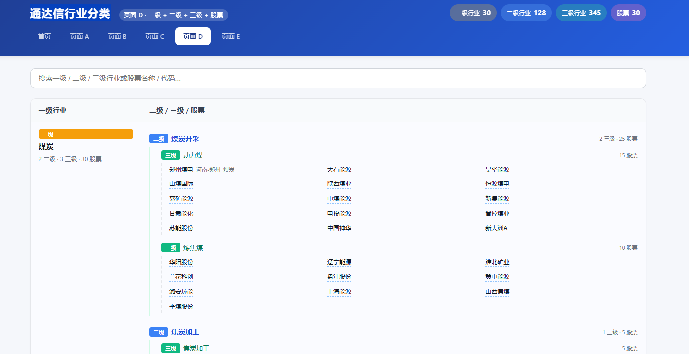

通达信行业分类



## PC 端 / 手机端

同一套服务，两个入口：

| 端     | 路径     | 代码位置                            |
|--------|----------|-------------------------------------|
| PC 端  | `/`      | `app.py`、`db.py`、`templates/`、`static/` |
| 手机端 | `/m/`    | `mobile/`（独立 Blueprint，模板与样式自成一目录） |

手机 UA 访问任意 PC 页面会自动 302 到 `/m/`，不会被跳走的请求包括：
`/static/`、`/stock_images/`、`/api/`。

想留在电脑版：访问 `/m/switch?to=pc`（写 cookie `force_view=pc`，180 天有效）；
反之 `/m/switch?to=mobile` 可强制手机 UA 之外的浏览器也进手机版。

### 手机端目录

```
mobile/
  __init__.py               Blueprint 创建 / 注册 / UA 自动跳转
  data.py                   只读数据层（复用 db.py，同一份 SQLite）
  views.py                  路由：首页 / 行业下钻 / 股票详情 / 搜索 / 更多
  templates/mobile/*.html   手机端模板
  static/css/mobile.css     手机端样式
  static/js/mobile.js       手机端交互
```

主程序只需挂载（见 `app.py`）：

```python
from mobile import register_mobile
register_mobile(app)
```

手机端当前提供：数据概览、一级→二级→三级→股票的逐级浏览、股票搜索、
图表查看。新增/编辑/删除等维护功能仍在 PC 端完成。